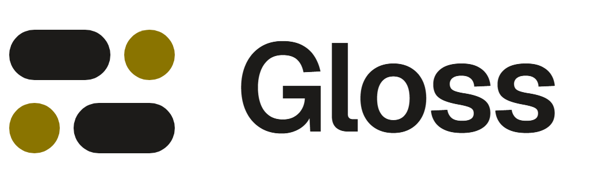

<p align="center">
  <picture>
    <source media="(prefers-color-scheme: dark)" srcset="docs/brand/gloss-logo-on-dark.png">
    
  </picture>
</p>

# Gloss

A video game translation tool that brings together the **game scene** (images with the original text, read by OCR), **world knowledge** (a per-project Markdown glossary) and **peer review**.

**Live demo:** [translator-tool-six.vercel.app](https://translator-tool-six.vercel.app). Press **Load demo** at the bottom left to explore a sample workspace.

> Status: early development (v1, local-first showcase). See [`docs/SPEC.md`](docs/SPEC.md) for the specification and [`docs/DECISIONS.md`](docs/DECISIONS.md) for technical decisions.

## Getting started

Requires Node.js 20 or later.

```bash
npm install
npm run dev      # http://localhost:5173
```

The first `dev` or `build` also prepares the OCR files in `public/ocr` (git-ignored): it copies the Tesseract engine from `node_modules` and downloads the language models (~20 MB, once). Run `npm run ocr:setup` to do it by hand.

| Command | Description |
|---|---|
| `npm run dev` | Development server |
| `npm test` | Unit tests (Vitest) |
| `npm run lint` | ESLint |
| `npm run typecheck` | TypeScript |
| `npm run build` | Production build into `dist/` |
| `npm run ocr:setup` | Prepare the OCR engine and language data in `public/ocr` |

## How data is stored

The app is **local-first**: everything is stored in your browser (IndexedDB). It starts with an empty workspace and a single manager; create a project and add your own scene images.

### Demo

The demo is kept in a separate repository, [translator-tool-demo](https://github.com/EduardoGomezPueyo/translator-tool-demo), so forks start clean. Set `VITE_DEMO_URL` (see `.env.example`) and a **Load demo** button appears below the avatar: it opens the demo in a workspace of its own, without touching your data, and **Exit demo** brings you back. The demo's project names are real game titles used as labels only; everything inside them is original.

`VITE_DEMO_IMAGES_URL` adds a **Try with real images** link to a separate collection of real game screenshots you can upload yourself. Those images belong to their owners and are not covered by this project's license.

All data access goes through repository interfaces, so you can plug in a backend without rewriting the UI. `VITE_DATA_SOURCE` (see `.env.example`) selects the implementation: `local` (the default) or `remote`. A Supabase reference adapter is planned for v2.

## Exporting translations

*Export to code* on a project page downloads the translations as **JSON** (one file with every string, its context and the chosen languages) or **CSV** (one column per language). By default only completed (reviewed) translations are included. Each string has a readable `key` (`act-1-opening.north-gate.01`) and a stable `id`; the full format is described in [`docs/DECISIONS.md`](docs/DECISIONS.md) (D33). New formats are added as adapters in `src/export`.

## Interface languages and themes

The interface is available in **English** and **Spanish** (`src/i18n/locales`), with **dark** and **light** themes. Both switches sit next to the avatar at the bottom of the sidebar.

## Project structure

```
src/
  app/        router, layouts, providers (theme, data source, current user)
  domain/     pure types and logic (progress, statuses, sorting) – no browser APIs
  data/       repository interfaces and the local IndexedDB implementation
  ocr/        OCR provider interface and the Tesseract.js implementation
  export/     export formats (JSON, CSV) behind one adapter interface
  features/   one folder per screen area (projects, settings, …)
  ui/         small reusable components
  i18n/       interface translations (en, es)
  test/       test helpers and fixtures
  styles/     design tokens and global styles
  assets/     icons exported from the design
```

## License

Gloss is free software, licensed under the [GNU Affero General Public License v3.0](LICENSE) (AGPL-3.0-only). You can use, study, change and share it; if you distribute a modified version, or run one as a service that others use over a network, you must make its source code available under the same license.

The demo content lives in a [separate repository](https://github.com/EduardoGomezPueyo/translator-tool-demo) with its own terms, and real game screenshots linked from the app belong to their respective owners.
